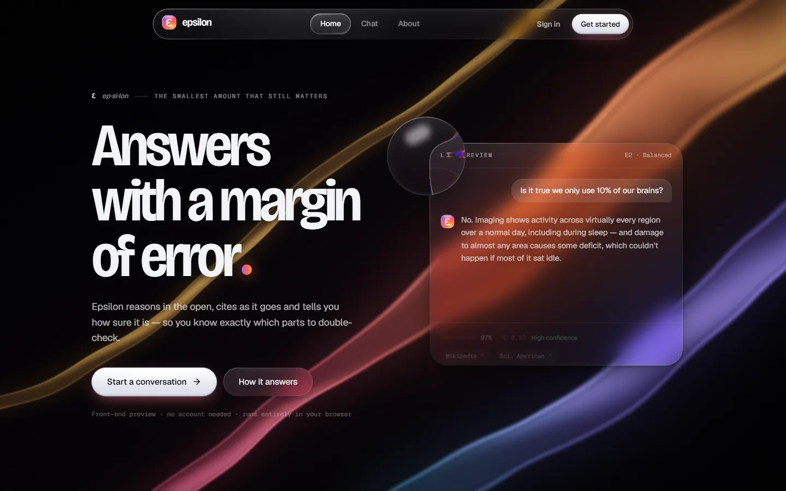
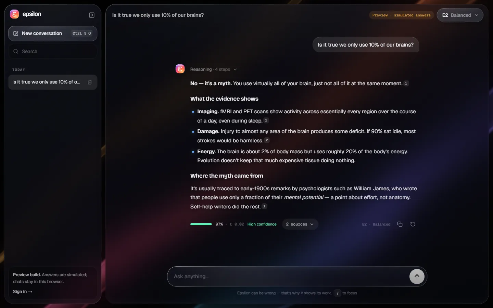
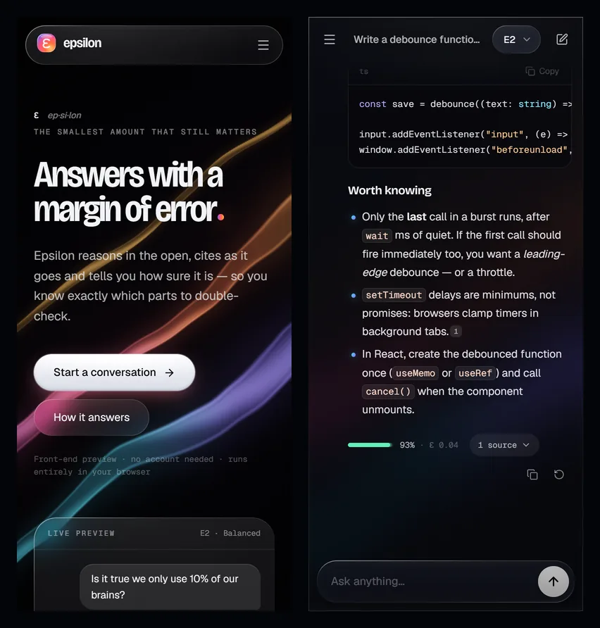

# Epsilon

**An AI assistant that shows its working: its reasoning, its sources and its margin of error.**

This repository is Epsilon's front end. It is a dark, liquid-glass interface: real refraction, a WebGL light field behind the glass and spring-based motion throughout. There is no model behind it yet. Answers to the sample questions are written by hand, and anything else gets an honest "not connected" reply.





<p align="center"></p>

## What's inside

**The material.** Every glass surface is built from three layers: a frosted body, a 1px specular rim whose bright edge turns to face the pointer, and a soft caustic sheen. On Chromium desktops the edges also _refract_. The app generates a displacement map for each surface's exact size and corner radius, and an SVG `feDisplacementMap` bends the backdrop through it, with a touch of chromatic dispersion. Sliding indicators (the nav, segmented controls, the 404 lens) use [`liquid-glass-web-react`](https://github.com/PallavAg/liquid-glass-web-react), which refracts the content under it in every browser.

**The light.** Behind the glass is a WebGL fragment shader: silk ribbons of colour drifting through a domain-warped noise field, pulled faintly toward the pointer. It renders at half resolution, caps its frame rate, pauses in background tabs and eases into a calmer mood on the chat page.

**The chat.**

- Simulated streaming with a thinking phase, an expandable reasoning trace, Markdown (tables, code with syntax highlighting and copy) and `[^n]` citations that link to their sources.
- A confidence meter on every factual answer, with a ±ε band. The wording of the answer matches the number.
- Three models (E1 Swift, E2 Balanced, E3 Deep) that change how long it "thinks" and how much reasoning it shows.
- Stop, regenerate, copy, search and delete. Conversations persist in `localStorage` and never leave the device.
- Keyboard shortcuts: <kbd>/</kbd> focuses the composer, <kbd>Enter</kbd> sends, <kbd>Shift</kbd>+<kbd>Enter</kbd> adds a new line, <kbd>Esc</kbd> stops a reply, <kbd>Ctrl/⌘</kbd>+<kbd>Shift</kbd>+<kbd>O</kbd> starts a new chat.

**Also:**

- A landing page whose sections are working demos rather than icon grids.
- An editorial About page.
- Sign-in, sign-up and password-reset screens with real client-side validation.
- A 404 page with a lens you can drag across the number.

**Accessible and mobile-ready.**

- Native form controls, visible focus rings, a focus-trapped mobile drawer and screen-reader announcements when an answer finishes.
- Respects `prefers-reduced-motion` and `prefers-reduced-transparency`.
- Uses `100dvh`, safe-area insets and a keyboard-aware viewport. Primary touch targets are 44px on phones.

## Getting started

Requires Node.js 20.9 or newer.

```bash
npm install
```

```bash
npm run dev
```

Then open http://localhost:3000.

| Script              | What it does                |
| ------------------- | --------------------------- |
| `npm run dev`       | Development server          |
| `npm run build`     | Static export to `out/`     |
| `npm run preview`   | Serve `out/` locally        |
| `npm run lint`      | Biome lint and format check |
| `npm run format`    | Apply Biome fixes           |
| `npm run typecheck` | TypeScript, no emit         |

## Project layout

```
src/
  app/                    routes (static export)
    (site)/               landing and about, with the floating nav and footer
    (auth)/               login, signup, forgot-password
    chat/                 the chat app
    globals.css           tokens, the glass material, prose, motion preferences
  components/
    backdrop/             WebGL light field
    glass/                light field, lens hook, LensRow
    chat/                 chat app, composer, messages, Markdown, model picker
    landing/              hero, "How it answers", models, CTA
    ui/ auth/ site/ brand/
  lib/
    chat/                 types, validated storage, canned answers, streaming
    models.ts
```

## Deploying

`npm run build` writes a fully static site to `out/`, which any static host can serve. `netlify.toml` is set up for Netlify, including security headers: a strict Content-Security-Policy, `X-Frame-Options: DENY`, `nosniff`, a referrer policy and a permissions policy. On other hosts, copy those headers into the host's config.

## Browser support

All current evergreen browsers. Edge refraction on glass panels needs Chromium on desktop (Chrome, Edge, Arc, Brave). It is skipped on touch devices to save battery. Elsewhere those panels fall back to frosted glass, which is designed to stand on its own.

## Security notes

- No credentials are logged, stored or sent anywhere. The auth screens are front-end only.
- Assistant Markdown is rendered to React elements, never to HTML strings, and links are limited to `http(s)` and `mailto`.
- Everything read back from `localStorage` is validated and size-capped before use.
- A question handed from the landing page to the chat travels through `sessionStorage`, not the URL, so it never lands in history or server logs.

## License

[GPL-3.0](LICENSE)
